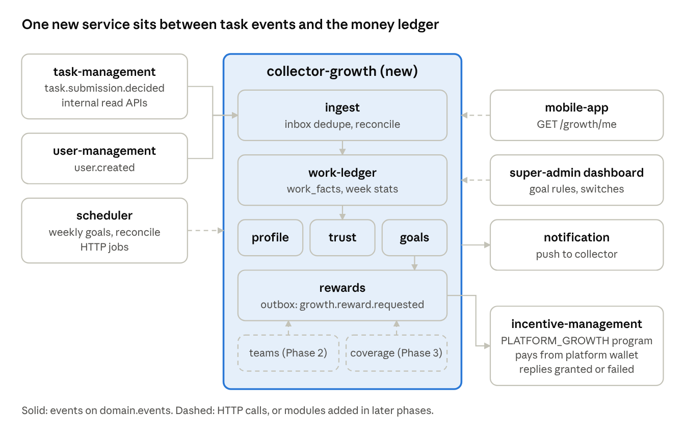

# Collector Growth System Design

Oct 16, 2026 · Belayneh

## Summary

We add one new NestJS service, `collector-growth`, built from `starter-kit`. It listens to task events, keeps its own PostgreSQL record of each collector's approved and rejected work, and computes level, Trust Score and weekly goals. It never moves money itself. When a goal is met, it sends a reward request event, and `incentive-management` pays it from the platform wallet through a new program type.

Phase 1 ships Strategy 1 (Collector Profile and Trust Score) and Strategy 2 (Weekly Goals and Steady Work Bonus). Strategy 1 is the base every other strategy reads from, so it is the one we pick to build first. Teams (Phase 2) and Extra Pay for Missing Areas (Phase 3) add modules to the same service and reuse the same ledger and reward path.

The existing code needs four small, additive changes before Phase 1 can work:

1. `task-management-service` must publish one new event, `task.submission.decided`, for every approved and rejected submission. Today it publishes approvals only when the task pays money, and it never publishes rejections as a domain event.
2. `incentive-management` must accept a new program type, `PLATFORM_GROWTH`, funded from `platform_wallets`, and a new inbound event, `growth.reward.requested`.
3. The mobile app gets a "My Work" screen. It shows only what the growth service says is turned on.
4. The super-admin dashboard gets a goal rules page.

No existing event, table or API changes shape. Each change can ship and be rolled back on its own.

## Scope and phasing

Every reward comes only from approved work. There are no leaderboards, no public ranks and no luck-based prizes. All amounts are in ETB.

| Phase | What collectors get | What ships | Gate to start |
| --- | --- | --- | --- |
| 0. Foundations | Nothing visible | New TMS event, `PLATFORM_GROWTH` in incentive-management, growth service in shadow mode | None |
| 1. Profile and goals | Level, Trust Score, weekly goal, goal bonus | Profile, Trust, Goals and Rewards modules, "My Work" screen, admin goal rules | Shadow numbers match TMS counts for 2 weeks |
| 2. Teams and invites | Team weekly goal, invite steps, level-gated tasks | Teams module, invite ladder, level token in TMS targeting | Phase 1 bonus cost within budget for 4 weeks |
| 3. Missing areas | Extra pay for work in areas with no data | Coverage module, server-side location check in TMS | Server location check live and accurate |
| Later | Certificates, loan signal, hiring view | Read APIs on the same ledger | Product decision |

In scope for this review: Phases 0 to 3 in design detail, with Phase 0 and 1 ready to build. Out of scope: certificate tests, the loan product itself, and any change to how submissions are reviewed.

## Current system review

The platform is a set of services that talk over one RabbitMQ topic exchange, `domain.events`, with a shared JSON envelope `{routingKey, payload, emittedAt}`. Each service has its own repo, `.gitlab-ci.yml` and `manifests/`. This is the pattern we follow.

| Service | Stack, store | What matters for this design |
| --- | --- | --- |
| task-management-service (TMS) | Express, TS, MongoDB | Owns tasks, submissions, review, offline sync, location targeting. Publishes `task.*` events directly with `publishEvent`, no outbox. |
| incentive-management | NestJS, PostgreSQL, TypeORM | Owns money: tenant and platform wallets, task budgets, earnings, bonus programs, payouts. Has an outbox, inbound consumer with retry and DLQ, idempotency on `payload.externalEventId`. |
| user-management-service | Django, PostgreSQL | Users, roles, JWT, KYC. Publishes `user.*` events. |
| scheduler | NestJS, PostgreSQL | Calls an HTTP endpoint on a cron. No broker, no SDK. |
| notification | NestJS | Consumes `send-*` keys on `notification.domain-events`. Push through Firebase. |
| starter-kit | NestJS 11, TypeORM, pg | Template with base repository, guards, collection query, observability. |
| mobile-app | Flutter | Modules for tasks, wallet, payout, referrals, notifications, onboarding. |
| super-admin and corporate-admin dashboards | Next.js, English and Amharic | Admin screens. Bonus programs and referrals already have pages. |

Two existing paths carry most of the load for this design:

- **Earning path.** TMS approves a submission and publishes `task.submission.approved`. incentive-management spends the task budget, creates the earning and credits the collector wallet in one transaction. `BonusEvaluationService.onEarningFinalized` then runs MULTIPLIER, FIRST\_EARNING and referral progress.
- **Referral path.** One global REFERRAL program, platform-funded from `platform_wallets.lockedBalance`, one code per collector, qualification on approved submissions or earned amount.

## Constraints in the current code

Each row is something in the code today that would block or slow phased delivery, and how the design handles it.

| # | Constraint (where) | Effect on this design | How we handle it |
| --- | --- | --- | --- |
| C1 | `emitSubmissionApproved` returns early when `tenantId` is missing or `amount` is 0 (TMS `events/domain/submissionEvents.ts`) | Unpaid or training tasks never reach any consumer. Counts would be wrong. | New event `task.submission.decided`, always emitted. The financial event stays as it is. |
| C2 | `task.submission.rejected` is in `routingKeys.ts` but only a notification is sent on reject | No rejection data for the Trust Score | `task.submission.decided` carries `outcome` and `reasonCode[]` |
| C3 | TMS publishes fire and forget (`void emit…`), no outbox, new random `messageId` each send | Events can be lost if RabbitMQ is down. Dedupe on `messageId` will not work. | Dedupe on `payload.externalEventId`. Nightly reconcile through a new TMS read endpoint. A TMS outbox is a recommended follow-up, not a blocker. |
| C4 | Approved payload has no `completedAt`. Offline work syncs late. | A goal week would count offline work in the wrong week | New event carries `completedAt` and `decidedAt`. Week is taken from `completedAt`, with a late-sync limit. |
| C5 | ONE\_OFF and MULTIPLIER debit the tenant wallet. Manual grant is ONE\_OFF only and tenant-scoped. | Growth bonuses are platform-paid, not paid by a corporate | New `PLATFORM_GROWTH` program type that locks budget on `platform_wallets`, like REFERRAL does |
| C6 | Only one active REFERRAL program globally, one threshold | Invite steps (Phase 2) need several steps | REFERRAL stays as is for the first step. Later steps are growth rewards keyed on the same `referral_attributions`. |
| C7 | MULTIPLIER is per program and task list, not per collector | A level-based boost cannot use it as built | Level perks in Phase 1 are not cash. Level-gated tasks come in Phase 2 through targeting tokens. |
| C8 | Location check trusts the app: `resolvedLocation` is computed on the client, and the mobile app does not send it today (`device_location.dart`). The code calls targeting "a routing aid, not an assurance". | Area-based pay can be gamed | Phase 3 is gated on a server-side area lookup in TMS |
| C9 | `starter-kit` has no RabbitMQ, outbox or consumer code. incentive-management has it in `src/common/events`. | The new service has no broker code out of the box | Copy the `common/events` folder into the new service. Extract a shared package later. |
| C10 | Scheduler: HTTP only, no idempotency header, `sk_` keys rejected | Weekly jobs can fire twice | Deterministic job names, `SCHEDULER_API_KEY` on platform routes, and job endpoints that are idempotent per week key |
| C11 | No feature flag system in mobile or backend | Cannot turn modules on per phase without an app release | The growth service owns module switches and returns them in `GET /growth/me`. The app hides what is off. |

## Proposed architecture

One new service, `collector-growth`, with one PostgreSQL database. Inside it, modules follow the same `api / application / domain / infrastructure` layout as `incentive-management`. Modules talk only through their application service interfaces and never read each other's tables. This lets a team own a module, and lets us split a module into its own service later without changing callers.



Work events flow in from the left. Money leaves only through `rewards` to incentive-management on the right. Phase 2 and 3 modules plug into the same ledger and reward path.

| Module | Phase | Owns | Reads from |
| --- | --- | --- | --- |
| `ingest` | 0 | Inbox table, event consumer, nightly reconcile | RabbitMQ, TMS read endpoint |
| `work-ledger` | 0 | One row per decided submission, weekly totals | `ingest` |
| `profile` | 1 | Level, level history | `work-ledger` |
| `trust` | 1 | Trust Score and its inputs | `work-ledger` |
| `goals` | 1 | Goal rules, weekly goals, progress, forgiveness | `work-ledger`, `profile`, TMS open task count |
| `rewards` | 1 | Reward requests and their status | `goals`, later `teams` and `coverage` |
| `settings` | 1 | Module switches, per tenant or global | None |
| `teams` | 2 | Teams, members, team goals | `work-ledger`, `rewards` |
| `coverage` | 3 | Area demand, extra pay offers | `work-ledger`, TMS area data |

The `rewards` module is the only exit for money. It writes a reward request to the outbox in the same transaction as the goal status change. incentive-management decides whether money moves. This keeps one source of truth for balances.

The collector-facing API is read-only in Phase 1. Collectors cannot set or change goals.

Admin screens live in `super-admin-dashboard`, which calls the growth service directly with the super-admin JWT.

## Data model and storage

PostgreSQL with TypeORM migrations, same as incentive-management and scheduler. We chose PostgreSQL over MongoDB because the core operations are unique keys, upserts and weekly aggregates inside transactions with the outbox. Week keys are ISO weeks in `Africa/Addis_Ababa`, Monday 00:00 start.

**Phase 0 and 1 tables**

| Table | Key | Main columns | Notes |
| --- | --- | --- | --- |
| `inbox_events` | `external_event_id` | `routing_key`, `received_at` | Insert first; a conflict means a duplicate, so skip |
| `work_facts` | `submission_id` | `collector_id`, `tenant_id`, `task_id`, `outcome`, `reason_codes[]`, `amount`, `completed_at`, `decided_at`, `week_key` | One row per decision. A later decision on the same submission updates the row. |
| `collector_week_stats` | `(collector_id, week_key)` | `approved`, `rejected`, `earned` | Updated in the same transaction as `work_facts` |
| `collector_profiles` | `collector_id` | `level`, `trust_score`, `approved_total`, `first_work_at`, `last_forgiven_week` | Read model for the app |
| `level_history` | `id` | `collector_id`, `from_level`, `to_level`, `reason`, `at` | Audit of level moves |
| `goal_rules` | `id`, `version` | `status`, `config jsonb` | DRAFT, ACTIVE, DISABLED, same lifecycle as bonus programs. One ACTIVE version at a time. |
| `weekly_goals` | `(collector_id, week_key)` | `rule_version`, `target`, `progress`, `status`, `bonus_amount` | OPEN, MET, MISSED, FORGIVEN |
| `reward_requests` | `id` | `collector_id`, `kind`, `amount`, `source_ref` (unique), `status` | REQUESTED, GRANTED, FAILED |
| `module_settings` | `(module, tenant_id)` | `enabled`, `config jsonb` | `tenant_id` null means global |
| `domain_event_outbox` | `id` | Same as incentive-management | Copied code |

`goal_rules.config` holds: `lookbackWeeks` (4), `upliftPct` (10), `minTarget`, `maxTarget`, `starterTarget`, `supplyFactor` bounds, `bonusByLevel` in ETB, `forgiveMissesPer` weeks, `lateSyncDays`.

**Later tables.** Phase 2 adds `teams`, `team_members`, `team_weeks`, `invite_steps`. Phase 3 adds `area_demand` and `coverage_offers`, and a nullable `area_tokens` column on `work_facts`. All are new tables or nullable columns, so no backfill blocks a deploy.

**Retention.** `work_facts` keeps 13 months. Weekly stats keep forever, they are small.

## Event flows and integrations

All events use `domain.events` and the existing envelope. The growth service binds its own queue, `collector-growth.events`, with a DLQ, copying the incentive-management consumer (3 retries, `x-retry-count`).

**Flow A: a submission is decided (real time)**

1. TMS approves or rejects a submission and publishes `task.submission.decided`.
2. `ingest` inserts `externalEventId` into `inbox_events`. A conflict means a duplicate, so it stops.
3. `work-ledger` upserts `work_facts` and `collector_week_stats` in the same transaction.
4. `trust` and `profile` recompute for that collector. A level change writes `collector.level.changed` and a `send-notification-to-user` message to the outbox.
5. `goals` adds to the open goal's progress. When progress reaches the target, the goal becomes MET and `rewards` writes `growth.reward.requested` to the outbox, all in one transaction.
6. incentive-management consumes it, debits the `PLATFORM_GROWTH` program's locked budget, credits the collector wallet and creates a `bonus_grants` row. It publishes `growth.reward.granted` or `growth.reward.failed`.
7. `rewards` updates the request status. On success, a push goes out through notification.

**Flow B: Monday goal setting (batch)**

1. Scheduler calls `POST /internal/jobs/weekly-goals` every Monday at 00:05 Addis time. The body carries `weekKey`.
2. The job closes last week: OPEN goals become MISSED, or FORGIVEN if the collector has no forgiven miss in the window.
3. For each collector active in the last 4 weeks, it computes the new target from `collector_week_stats`, the active rule and the open task count near the collector. New collectors get `starterTarget`.
4. Rows are inserted with `ON CONFLICT DO NOTHING`, so a second run of the same week changes nothing.
5. One `send-notification-to-users` message per batch tells collectors their goal is ready.

**Flow C: nightly reconcile**

Scheduler calls `POST /internal/jobs/reconcile` each night. `ingest` pulls decided submissions for the last 3 days from a new TMS endpoint and replays any it has not seen. This covers C3.

**New event contract: `task.submission.decided`**

```json
{
  "routingKey": "task.submission.decided",
  "payload": {
    "externalEventId": "tms:submission-decided:<submissionId>:<attempt>",
    "submissionId": "sub-abc",
    "taskId": "507f1f77bcf86cd799439011",
    "tenantId": "uuid or null",
    "collectorId": "collector-user-id",
    "outcome": "APPROVED",
    "reasonCode": [],
    "amount": 50,
    "currency": "ETB",
    "completedAt": "2026-10-12T09:14:00.000Z",
    "decidedAt": "2026-10-13T08:00:00.000Z",
    "attempt": 1
  },
  "emittedAt": "2026-10-13T08:00:01.000Z"
}
```

**Integration points**

| System | Direction | How | Change needed |
| --- | --- | --- | --- |
| TMS | in | `task.submission.decided` event | Emit in `submissionService` next to the existing approve and reject calls |
| TMS | in | `GET /internal/submissions/decided?since=` | New internal route, service token |
| TMS | in | `GET /internal/tasks/open-count?areas=` | New internal route, used only by Flow B |
| incentive-management | out and in | `growth.reward.requested`, `growth.reward.granted`, `growth.reward.failed` | New program type, new consumer handler, outbox events |
| user-management | in | `user.created` | None, already published |
| scheduler | in | HTTP jobs with `SCHEDULER_API_KEY` | Register 2 jobs |
| notification | out | `send-notification-to-user`, `send-notification-to-users` | None |
| auditing | out | `audit.record` for rule changes and manual adjustments | None |

## Module interfaces

These are the contracts teams build against. Each one is versioned. A change that removes or renames a field needs a new version, not an edit.

**Inside the growth service** (TypeScript interfaces, one per module, exported from its `application` folder)

```ts
interface WorkLedger {
  record(fact: DecidedSubmission): Promise<RecordResult>;
  weekStats(collectorId: string, weekKeys: string[]): Promise<WeekStats[]>;
}

interface ProgressListener {
  onWorkRecorded(e: WorkRecorded, tx: EntityManager): Promise<void>;
}

interface RewardPort {
  request(r: { collectorId: string; kind: RewardKind; amount: number; sourceRef: string }, tx: EntityManager): Promise<string>;
}
```

`goals`, `trust` and `profile` each register as a `ProgressListener` in Phase 1. `teams` and `coverage` register the same way later. The ledger does not import any listener, so adding Phase 2 and 3 is a new registration, not an edit to the ledger. `RewardKind` is an open string enum: `GOAL` in Phase 1, `TEAM_GOAL` and `INVITE_STEP` in Phase 2, `COVERAGE` in Phase 3. incentive-management stores it as grant metadata and does not branch on it.

**HTTP API of the growth service** (prefix `/api/v1/growth`, JWT from user-management)

| Method and path | Caller | Phase | Returns |
| --- | --- | --- | --- |
| `GET /me` | Mobile app | 1 | Level, Trust Score, current goal and progress, enabled modules |
| `GET /me/weeks?limit=12` | Mobile app | 1 | Past weeks with target, result, bonus |
| `GET /goal-rules`, `POST /goal-rules`, `PUT /goal-rules/:id`, `POST /goal-rules/:id/activate` | Super-admin | 1 | Rule versions, DRAFT to ACTIVE |
| `POST /goal-rules/:id/preview` | Super-admin | 1 | Target spread and cost estimate for next week, no writes |
| `GET /settings`, `PUT /settings/:module` | Super-admin | 1 | Module switches |
| `POST /internal/jobs/weekly-goals`, `POST /internal/jobs/reconcile` | Scheduler | 0 and 1 | 202 with job run id |
| `GET /collectors/:id/work-summary` | Kifiya internal | Later | Approved work history for hiring and loan signals |
| `GET /me/team`, `POST /teams`, `POST /teams/:id/join` | Mobile app | 2 | Team data |

**Events published by the growth service**

| Routing key | Consumer | Phase |
| --- | --- | --- |
| `growth.reward.requested` | incentive-management | 1 |
| `collector.level.changed` | TMS (Phase 2 targeting), analytics | 1 |
| `collector.goal.closed` | Analytics | 1 |
| `send-notification-to-user(s)` | notification | 1 |

**incentive-management additions**

- `BonusProgramType.PLATFORM_GROWTH` with config `{ maxPerCollectorPerWeek: number }`. `tenant_id` is null and it requires `budgetCap`, like REFERRAL. More than one may be ACTIVE. It cannot be triggered by task earnings.
- `BonusGrantType.PLATFORM_GROWTH`.
- Consumer handler for `growth.reward.requested`. Idempotent on `externalEventId = growth:reward:<requestId>`.

## Phase plan

Each phase is deployable alone and leaves the system working. Deploy order inside a phase is always: consumers first, then producers, then the app. A consumer that gets an event it does not know ignores it, so the order never breaks a running system.

**Phase 0: Foundations (no user change)**

| Work item | Team | Depends on | Rollback |
| --- | --- | --- | --- |
| Create `collector-growth` repo from `starter-kit`, copy `common/events`, CI and manifests | Growth | None | Delete deployment |
| `ingest` and `work-ledger` modules, reconcile job | Growth | Event contract agreed | Turn off consumer |
| Emit `task.submission.decided` in TMS | TMS | Contract agreed | Remove the emit call; nothing else reads it yet |
| `GET /internal/submissions/decided` in TMS | TMS | None | Remove route |
| `PLATFORM_GROWTH` type and `growth.reward.requested` handler | Incentive | Contract agreed | Leave unused; no program is ACTIVE |

Exit check: for 2 weeks, ledger counts per collector match TMS approved and rejected counts. The service runs in shadow mode and shows nothing.

**Phase 1: Profile, Trust Score, Weekly Goals**

| Work item | Team | Depends on |
| --- | --- | --- |
| `profile`, `trust`, `goals`, `rewards`, `settings` modules | Growth | Phase 0 |
| Weekly job and scheduler registration | Growth | Phase 0 |
| `GET /internal/tasks/open-count` in TMS | TMS | None |
| "My Work" screen: level, Trust Score, goal bar, past weeks | Mobile | `GET /me` contract, can build on a mock |
| Goal rules page with preview, module switches | Admin web | Rules API contract, can build on a mock |
| Super-admin tops up platform wallet, creates and activates a `PLATFORM_GROWTH` program with `budgetCap` | Ops | Incentive work from Phase 0 |

Launch steps: turn on `profile` and `trust` first, with no money. One week later, turn on `goals` with a small pilot group and a low `budgetCap`. Then widen.

**Phase 2: Teams and invites.** Add `teams` as a new `ProgressListener` and new `RewardKind` values. Invite steps read the existing `referral_attributions` through a new read endpoint in incentive-management. TMS consumes `collector.level.changed` and adds a `level:<name>` token to the collector profile `selections`, so `audienceFilter` can gate tasks by level with no new matching code. Nothing in Phase 1 is edited.

**Phase 3: Extra pay for missing areas.** First, TMS resolves area tokens on the server from the GPS point and the `Locations` data, and stops trusting `resolvedLocation` from the app. Then `task.submission.decided` gains an optional `areaTokens` field. The `coverage` module registers as a listener and requests `COVERAGE` rewards. Old events without the field still work.

**Later.** Certificates, loan signal and hiring view are read APIs over `work_facts` and `collector_profiles`. They need no change to the write path.

## Risks

| Risk | Impact | Mitigation | How phasing helps |
| --- | --- | --- | --- |
| Lost TMS events (C3) | Goals show wrong progress, missed bonuses | Nightly reconcile, dedupe on `externalEventId` | Phase 0 shadow run measures the loss rate before any money depends on it |
| Double payment | Money loss | Unique `source_ref` on `reward_requests`, idempotent incentive handler, goal status change and outbox write in one transaction | First money in Phase 1 pilot has a low `budgetCap` |
| Bonus cost runs over | Budget overrun | `PLATFORM_GROWTH` locks budget up front. When it is spent, requests fail cleanly and goals show "bonus paused". `POST /goal-rules/:id/preview` shows cost before activation. | Pilot group first, then widen |
| Goals feel unfair (too high or too low) | Collectors lose trust | Min and max caps, starter goal, one forgiven miss, admin preview | Profile ships a week before goals, so we see real numbers first |
| Offline work synced after the week closes | Missed goal that should be met | `lateSyncDays` window: a late fact for a closed week re-opens the check once and pays if met | Shadow run shows real sync delays |
| Gaming with low-quality work | Paying for bad data | Rewards follow approval only. Trust Score drops with rejections and lowers the bonus. | Area pay waits for server location checks |
| GPS spoofing for area pay (C8) | Paying for fake coverage | Server-side area lookup, plus speed and distance checks | Phase 3 is gated on it |
| Weekly batch slows as collectors grow | Late Monday goals | Keyset pagination in chunks of 1,000, one transaction per chunk, resumable by `weekKey` | None needed early |
| Mobile release lag | New screens reach users slowly | Module switches in `GET /me`. Ship the screen hidden, turn on from admin. | App can ship ahead of backend |
| Copied event code drifts from incentive-management | Two versions to fix | Extract `common/events` to a shared package after Phase 1 | Copy is acceptable while only two services use it |

## Alternatives considered

| Decision | Chosen | Rejected | Why |
| --- | --- | --- | --- |
| Where the logic lives | New `collector-growth` service | Inside incentive-management | incentive-management is the money ledger. Adding weekly batches and engagement rules there widens the blast radius of every change to payouts. |
|  |  | Inside TMS | TMS is on the hot path for submissions and offline sync, and stores in MongoDB. A weekly batch there competes with collectors syncing work. |
|  |  | One service per strategy | Too many deploys for a small team. Modules with clear interfaces give the same split later, when load or ownership needs it. |
| How rewards are paid | Event `growth.reward.requested` to a new `PLATFORM_GROWTH` program | Call `POST /bonus-programs/:id/grant` (ONE\_OFF MANUAL) | That path is tenant-scoped and debits the tenant wallet (C5). Growth bonuses are platform-paid. |
|  |  | Growth service holds its own wallet | Two money ledgers would need reconciling. incentive-management already has budget locks and payouts. |
| Source of work data | New `task.submission.decided` event | Reuse `task.submission.approved` | It skips unpaid tasks and has no rejections (C1, C2). Changing its meaning risks the earning path. |
|  |  | Pull from TMS analytics on read | Analytics are per task and tenant, not per collector across tenants, and keep no goal history. Every app open would hit TMS. |
| Store | PostgreSQL | MongoDB | Unique keys, upserts and the outbox in one transaction are simpler in PostgreSQL. It matches incentive-management, so the copied event code works as is. |
| Goal setting | Weekly batch from scheduler | Compute on first app open each week | Batch gives a fixed, auditable target and one notification. On-open creates a race with the first submission of the week. |
| Feature switches | `settings` module in the growth service | Add a platform flag service | No flag service exists (C11). A new shared service is outside this scope. The switch API can move to one later. |
| Shared event code | Copy from incentive-management | Shared npm package now | No internal package registry was found in the repo. Copying unblocks Phase 0. |

## Assumptions and open questions

Please confirm or correct each one. Each names what changes if it is wrong.

| # | Assumption | If wrong |
| --- | --- | --- |
| A1 | "Pick the best one" means: build all four strategies in phases, with Strategy 1 first as the base. | If only one strategy is approved, drop Phases 2 and 3. Phase 0 and 1 stay the same. |
| A2 | Growth bonuses are paid by Platform-X from the platform wallet, not by corporates. | If corporates fund them, `PLATFORM_GROWTH` becomes tenant-scoped and debits tenant wallets. |
| A3 | A collector's work across all tenants counts toward one profile and one goal. | If per tenant, keys gain `tenant_id` and the app shows one goal per tenant. |
| A4 | A new service and repo are allowed, with the same CI and Kubernetes setup as the others. | If not, the same modules go inside incentive-management as a separate Nest module with its own schema. |
| A5 | All services validate the user-management JWT the same way. | If not, the growth service needs its own auth guard. |
| A6 | The `Locations` data has polygons or enough detail to map a GPS point to an area on the server. | If not, Phase 3 needs an area data project first. |
| A7 | The annotation-management-service is not involved. Its README is the GitLab template only. | If it produces approved work, it must also emit `task.submission.decided`. |
| A8 | Weeks run Monday to Sunday, Addis time. Retention of `work_facts` is 13 months. | Config change only. |
| A9 | Trust Score starts as a smoothed approval rate over the last 90 days, scaled 0 to 100, with weights per rejection reason. | The formula sits behind the `trust` module interface, so it can change without touching other modules. |
| A10 | Expected scale for Phase 1 is in the tens of thousands of collectors, not millions. | Above that, move the weekly batch to a worker pool and partition `work_facts` by month. |

**Open questions**

- [ ] Who owns the `collector-growth` service and on-call?
- [ ] Bonus amount per level, and the Phase 1 pilot `budgetCap` in ETB.
- [ ] Can a submission be re-decided after approval (for example, a later reversal)? If yes, should a paid goal be clawed back?
- [ ] Should zero-pay tasks count toward goals?
- [ ] Is a TMS outbox on the roadmap? It would let us retire the nightly reconcile.
- [ ] Does the mobile app send `resolvedLocation` anywhere today? `device_location.dart` sends only the point. This may already be a bug for `locationAware` tasks.
